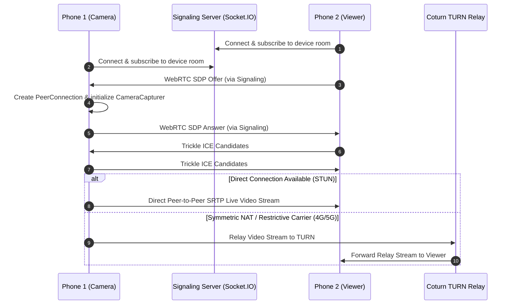

# VIRTUAL — Architecture & Technical Specifications

## 1. System Overview

**VIRTUAL** is a production-oriented two-device remote live-camera system. Both Phone 1 (Camera Device) and Phone 2 (Viewer Device) install the exact same Android application package (APK).

The core principle is:
- **Phone 1** continuously captures camera frames using Android CameraX and streams them live.
- **Phone 2** remotely connects and renders the live video stream over the internet.
- **Video Transport**: Direct WebRTC Peer-to-Peer with automatic STUN discovery and dedicated coturn TURN relay fallback.
- **Database Rule**: The PostgreSQL database and Node.js backend handle identity, authentication, pairing metadata, device telemetry, and signaling. **No video frames ever touch the database or disk.**

```
+-------------------------------------------------------------+
|                     VIRTUAL ECOSYSTEM                       |
+-------------------------------------------------------------+
               
  [ Phone 1 (Camera) ]                        [ Phone 2 (Viewer) ]
  • Role: Camera Device                       • Role: Viewer Device
  • CameraX Hardware Capture                  • WebRTC SurfaceViewRenderer
  • Foreground Service ("camera")             • Low-Latency Display
  • Partial WakeLock                          • Audio Controls
  • Camera Conflict Detector                  • Connection Management
           │                                             │
           ├─────────────── Signaling Socket ────────────┤
           │             (SDP Offer / Answer / ICE)      │
           ▼                                             ▼
+─────────────────────────────────────────────────────────────+
|               Node.js + TypeScript Backend                  |
|  • REST API (Auth, Devices, Pairings, Sessions)             |
|  • WebRTC Signaling (Socket.IO Rooms)                       |
|  • PostgreSQL Database (Prisma ORM)                         |
|  • Firebase Cloud Messaging (Push Notifications)            |
+─────────────────────────────────────────────────────────────+
           │                                             │
           ▼                                             ▼
+─────────────────────────────────────────────────────────────+
|               WebRTC Media Layer (Internet)                 |
|                                                             |
|  Direct P2P:   Phone 1 ═════════════════════════► Phone 2   |
|                                                             |
|  NAT Fallback: Phone 1 ═══► [ Coturn TURN ] ════► Phone 2   |
+─────────────────────────────────────────────────────────────+
```

---

## 2. One-Time Permanent Pairing Flow

Pairing occurs once during initial setup and is persisted permanently in PostgreSQL and on-device via `EncryptedSharedPreferences`.

```mermaid
sequencePosition
sequenceDiagram
    autonumber
    actor User as User
    participant Cam as Phone 1 (Camera)
    participant Srv as Backend Server
    participant DB as PostgreSQL
    participant View as Phone 2 (Viewer)

    User->>Cam: Select "Camera Device" & Grant Camera Permission
    Cam->>Srv: POST /api/pairing/create { cameraDeviceId }
    Srv->>DB: Store pending pairing with 10-minute SHA-256 token hash & "ABC-123" code
    Srv-->>Cam: Returns token, pairingCode ("ABC-123"), and QR payload
    Cam->>Cam: Render Blue+White QR Code Bitmap

    User->>View: Select "Viewer Device"
    User->>View: Scan QR Code or Type "ABC-123"
    View->>Srv: POST /api/pairing/join { viewerDeviceId, pairingCode }
    Srv->>DB: Validate code, invalidate temporary token, set status = ACTIVE
    Srv->>Cam: Socket Event: pairing_success
    Srv-->>View: Returns confirmed permanent pairing info
    Cam->>Cam: Save permanent pairing & navigate to Camera Dashboard
    View->>View: Save permanent pairing & navigate to Viewer Dashboard
```

---

## 3. WebRTC Live Video Streaming Lifecycle



---

## 4. Phone 1 Foreground Service & Screen-Off / Locked Mode

1. **Android 14 (API 34) Foreground Service Type**:
   - Manifest declares: `<service android:foregroundServiceType="camera" />`.
   - Starts via `startForegroundService` on explicit user command.
   - Shows persistent Android notification: "🟢 Live Camera Active — Streaming feed to authorized viewers" with a "Stop Streaming" action.
2. **Screen-Off / Locked Operation**:
   - Acquires `PowerManager.PARTIAL_WAKE_LOCK` to keep CPU active when the screen locks.
   - Prompts user to disable aggressive manufacturer battery optimization (`ACTION_REQUEST_IGNORE_BATTERY_OPTIMIZATIONS`).
3. **Graceful Camera Conflict Handling**:
   - Listens to Android system camera events via `CameraManager.AvailabilityCallback`.
   - When non-camera apps are opened (WhatsApp text chat, Instagram feed, TikTok feed, browser), the camera stream continues without interruption.
   - When a competing app opens the hardware camera (Instagram camera, TikTok recording, WhatsApp video call), `onCameraUnavailable` triggers:
     - Sets stream status to `CONFLICT_BUSY`.
     - Emits `camera_busy(true)` over signaling socket.
     - Viewer displays: *"Camera temporarily unavailable. Another application is currently using the camera. VIRTUAL will retry when the camera becomes available."*
     - As soon as the other app releases the camera, `onCameraAvailable` triggers, VIRTUAL automatically re-binds capture, and resumes live video streaming.
