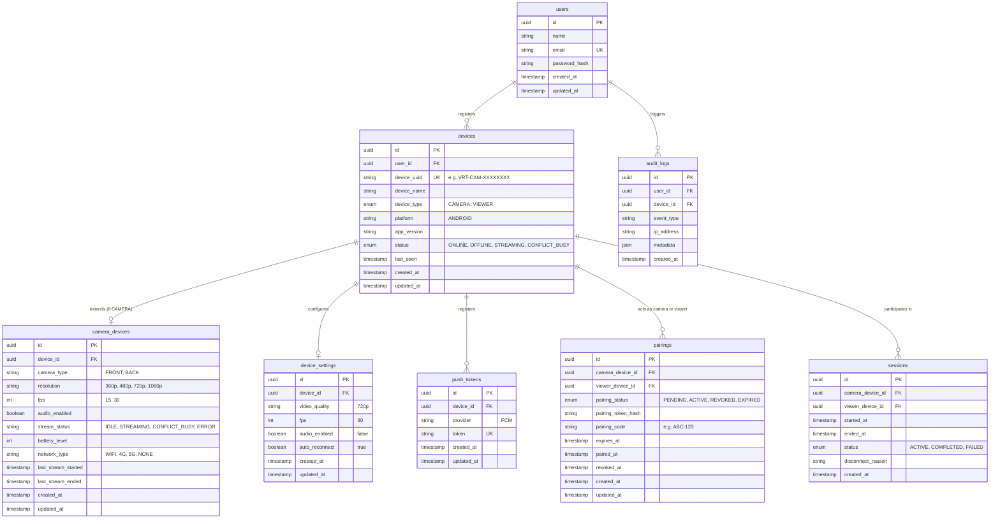

# VIRTUAL — PostgreSQL Database Schema

## 1. Storage Philosophy & Golden Rule

> **Important Rule**: The database is **NOT** the video transport system.
> The database strictly stores users, registered devices, permanent authorized pairings, settings, session metadata, device telemetry, and security audit logs.
> Live video frames travel exclusively through WebRTC peer-to-peer or coturn TURN relays.

---

## 2. Entity-Relationship Overview

---

## 3. Pairing Security Model

1. When a camera generates a pairing code, a **cryptographically secure random token** is generated and hashed with SHA-256 before storing in `pairings.pairing_token_hash`.
2. A human-friendly 6-character code (`ABC-123`) is stored in `pairings.pairing_code` with a 10-minute expiry (`expires_at`).
3. Upon viewer claim:
   - `pairing_status` transitions from `PENDING` to `ACTIVE`.
   - `pairing_token_hash` and `pairing_code` are set to `NULL` (invalidated).
   - `paired_at` is stamped.
4. Permanent pairing remains valid across reboots and app restarts until explicitly revoked via `DELETE /api/pairing/:id`.
